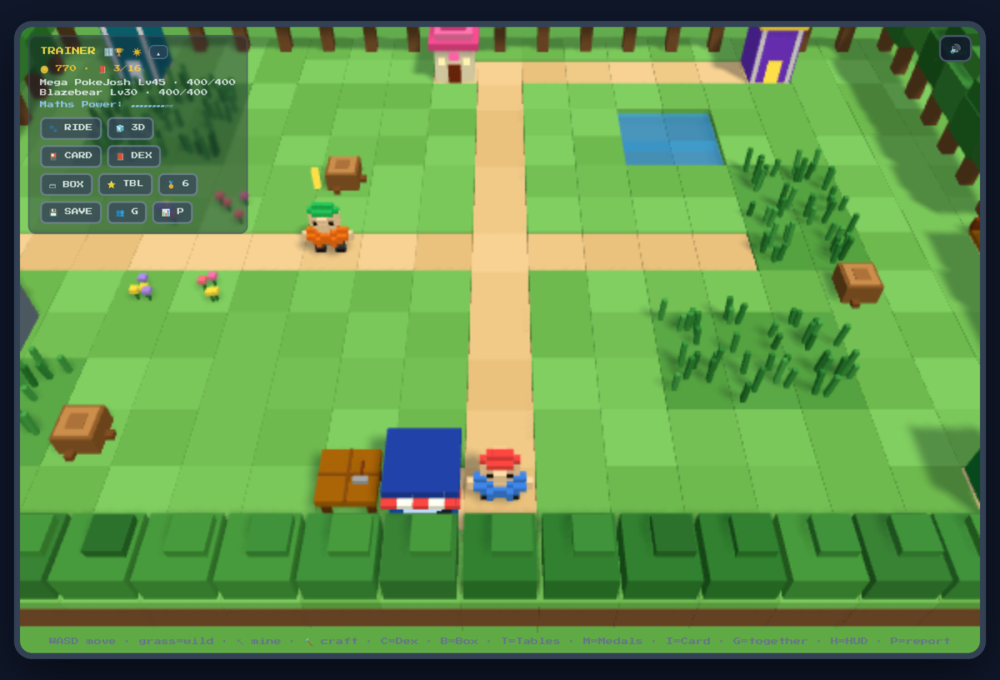
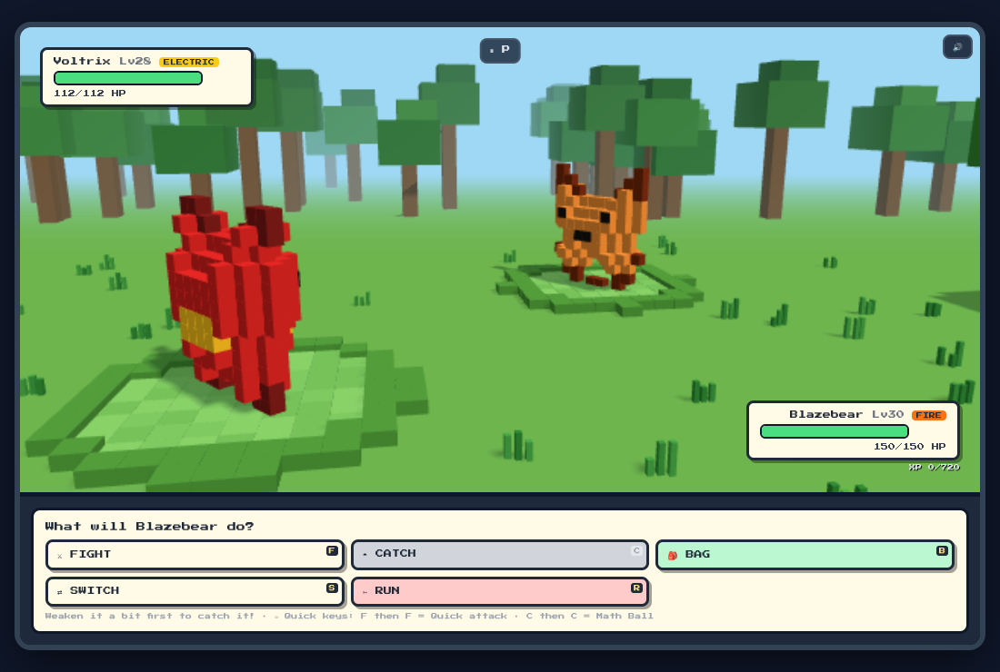
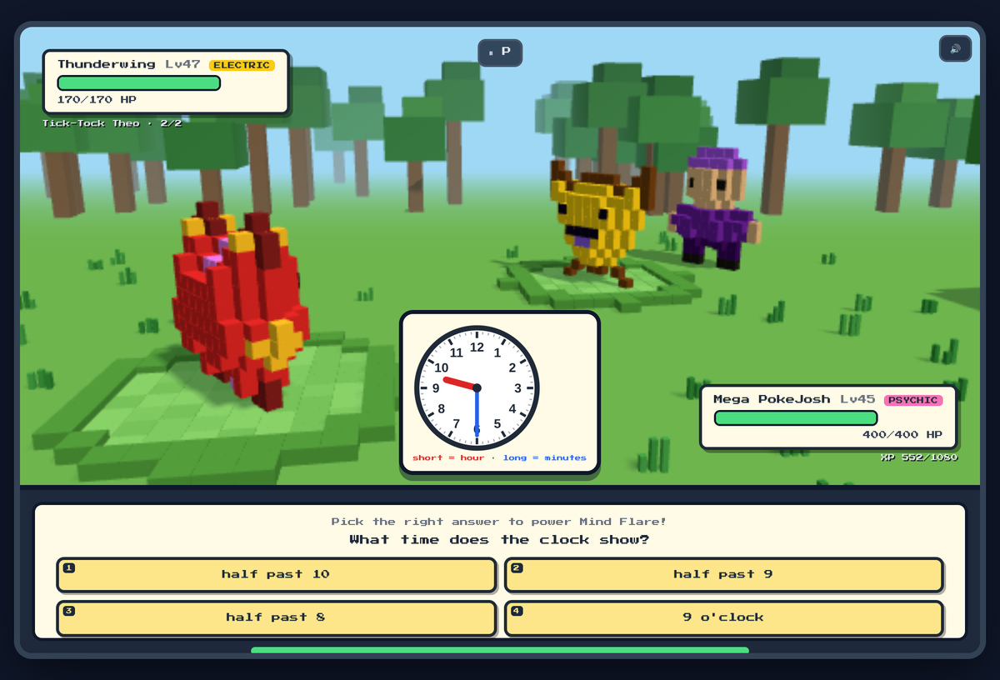
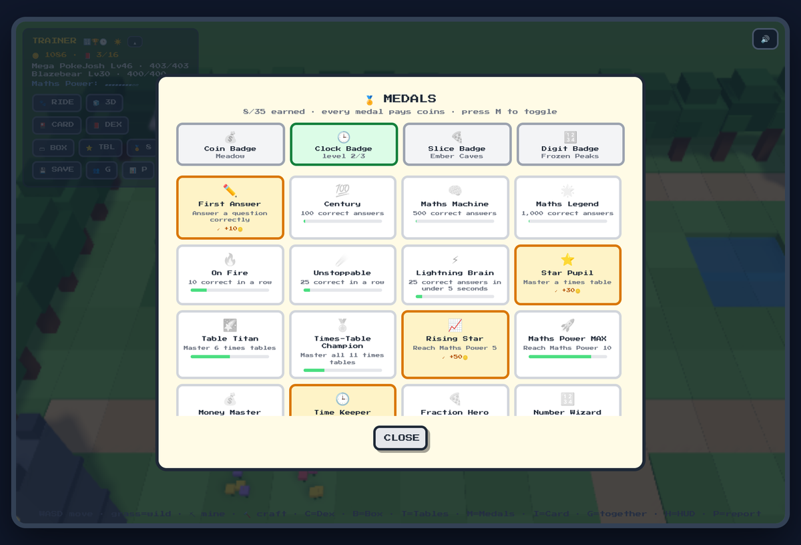

# 🐉 Mathimal Quest

**A 3D voxel creature-collecting adventure where every move is powered by a maths question.**

Explore three regions, catch 16 original creatures called *Mathimals*, beat gym leaders and the Elite Four, and become Grand Champion. Answering correctly makes your Mathimals attack, catch and grow. The questions get harder as the player gets faster.

The game is one HTML file. It runs offline, needs no install and doesn't collect any data.



| Battle | Topic gym: reading a clock | Medals |
|---|---|---|
|  |  |  |

---

## ▶️ Play it

1. Download **[`dist/mathimal-quest.html`](dist/mathimal-quest.html)**. On the file page, click **Download raw file**.
2. Double-click it to open it in **Chrome** or **Edge**.
3. Press **PRESS START** and pick a partner.

It's designed for a **laptop or desktop with a keyboard**. Phones and tablets aren't supported.

> **Tip:** If the 3D view is slow on an older computer, press **3D** on the in-game HUD to switch to the 2D view.

A printable **[Field Guide & Trainer's Manual](docs/Mathimal-Quest-Field-Guide.pdf)** (13 A4 pages) covers every Mathimal, gym, item and medal.

---

## ✨ Features

**Adventure**
- Three regions: the **Meadow**, the **Ember Caves** and the **Frozen Peaks**. Each one unlocks through progress.
- Day and night cycle, with different Mathimals out at night.
- Gym leaders, a recurring **rival**, the **Elite Four** gauntlet and **Grandmaster Aria**.
- **Trainer Tower**, an endless climb with escalating floors.
- **Aurion**, a legendary that appears only once every regular species has been caught.

**Collecting**
- 16 original Mathimals with evolutions at level 8, plus shiny variants.
- Common, uncommon and rare spawns.
- A team of 4 plus a Box.
- Seven ball types: Math, Great, Dusk, Net, Timer, Heal and Mega.

**Maths**
- **Adaptive difficulty ("Maths Power" 1–10).** It covers addition, subtraction, times tables, division, missing numbers and word problems. It rises only on answers that are both correct and quick, so it tracks fluency rather than lucky guesses.
- **Four Topic Gyms**, each with three levels that step up with practice:

  | Gym | Topic | Questions |
  |---|---|---|
  | 💰 Coin Gym | Money | New Zealand coins and notes, change, dollars and cents |
  | 🕒 Clock Tower | Telling time | Drawn analogue clocks: o'clock to 5-minute times, elapsed time |
  | 🍕 Fraction Forge | Fractions | Fractions of a number, fraction bars, comparing fractions |
  | 🔢 Number Vault | Place value and patterns | Digit values, rounding, number sequences |

- **Times-table stars** for mastering each table from 2 to 12.
- A **training report** showing accuracy and speed by question type.

**Rewards**
- **35 medals** that pay in-game coins.
- **Combo** meter and speed bonus.
- Shop, **mining and crafting** (wood, ore and crystal), Mystery Eggs, outfits and riding Mathimals.
- **Parent reward codes** that can be redeemed in-game for real-life wins. They aren't listed here on purpose.

**Quality of life**
- Fully **keyboard-playable**: every battle button shows its hotkey.
- Pause, and a confirmation before running away.

---

## ⌨️ Controls

| In the world | | In a battle | |
|---|---|---|---|
| `W A S D` / arrows | Walk | `F` then `F` | Fight with a Quick attack (`1` Quick, `2` Power) |
| `C` | Mathi-Dex | `C` then `C` | Catch with a Math Ball (`1`–`7` picks a ball) |
| `B` | Box | `B` | Bag |
| `T` | Times-table stars | `S` | Switch Mathimal (`1`–`4`) |
| `M` | Medals | `R` | Run (`Y` / `N`) |
| `I` | Trainer Card | `Enter` | Submit a typed answer |
| `P` | Training report | `1`–`4` | Pick a multiple-choice answer |
| `H` | Hide / show HUD | `P` | Pause |
| `Esc` | Close a window | `Esc` | Go back |

---

## 💾 Saving

- **Auto-save** writes to the browser's `localStorage` on that computer. Reopen the file and choose **Continue Adventure**.
- **New Adventure** asks for confirmation first, and **Restore Previous Adventure** can bring the replaced game back.
- **Save codes** (💾 SAVE in the game) hold the whole adventure as a checksummed code. You can copy it or download it as a `.txt` file. Use save codes to back up a game or move it to another computer.
- If the browser blocks storage (for example, in a private window), a red warning appears so progress isn't lost silently.

Updating to a new version is safe: replace the HTML file in the same place and progress carries over.

---

## 🛠️ Building from source

The whole game is one React component in [`src/mathimal-quest.jsx`](src/mathimal-quest.jsx). The 3D world uses Three.js.

```bash
npm install
npm run build        # writes dist/mathimal-quest.html
```

[`build.mjs`](build.mjs) bundles React 18 and Three.js into a single minified script with esbuild, then inlines it into one HTML file of about 790 KB.

### Project layout

```
├── src/
│   ├── mathimal-quest.jsx   # the game: data, question generators, React UI, Three.js renderer
│   └── entry.jsx            # mounts <App />
├── dist/
│   └── mathimal-quest.html  # the playable single-file build
├── docs/
│   ├── Mathimal-Quest-Field-Guide.pdf
│   └── screenshots/
├── build.mjs
└── package.json
```

### How it fits together

- **Rendering.** Creatures are 12×12 pixel sprites, extruded into voxel models at runtime and batched with `InstancedMesh`. The renderer adapts its quality to the computer's frame rate, and falls back to a 2D tile view when WebGL isn't available.
- **Questions** come from pure generator functions. The difficulty tier depends on Maths Power and, for topic gyms, on how many questions of that topic have been answered correctly.
- **Saves** go through a single `validateState()` before they're applied, whichever path they come from: auto-save, save code or restore. Save codes are versioned (current format v8, with older codes still accepted) and protected by an FNV-1a checksum.

---

## ✅ Testing

Before each release the game was checked with:
- automated play-throughs in a simulated browser
- logic-level acceptance tests for saving, validation, capacity limits and answer handling
- real-browser keyboard tests in headless Chromium
- 36,000+ generated topic questions, each re-checked against an independent answer calculator

Two rounds of independent stress testing found bugs, which were fixed in v4.2 and v4.4.

---

## 📜 Version history

| Version | Highlights |
|---|---|
| **v4.4** | Equivalent fractions (1/2 = 2/4) accepted and never offered as two separate choices; Box capacity handled the same way everywhere; one-action-per-turn lock; battle timers cancelled when a battle closes |
| **v4.3** | Four Topic Gyms (money, time, fractions, place value); 35 medals |
| **v4.2** | Complete save codes, start-over protection with restore, save-failure warning, stronger save validation, pause fixes |
| **v4.1** | Full keyboard control in battles |
| **v4.0** | 3D voxel world and battles |
| Earlier | Meadow, Ember Caves and Frozen Peaks; gyms, rival, Elite Four, Trainer Tower and Aurion; catching, ball types, Mystery Eggs, mining, crafting and riding; adaptive maths, times-table stars, combo meter, Trainer Card and auto-save |

---

## 💛 Credits

Made as a family project for a young Mathimal trainer. **PokeJosh**, the psychic fire dragon, was designed by the player the game was made for.

All creatures, characters and artwork are original. Mathimal Quest isn't affiliated with any existing game franchise.

## Licence

Personal project. All rights reserved unless a `LICENSE` file says otherwise.
