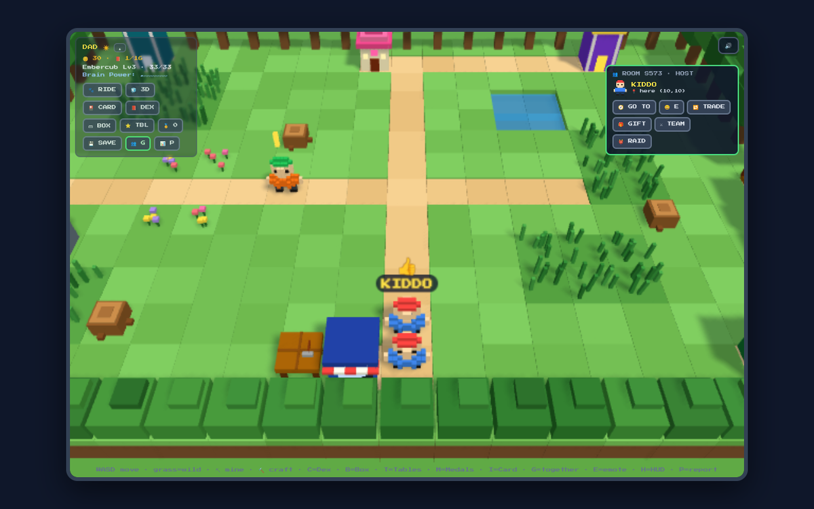
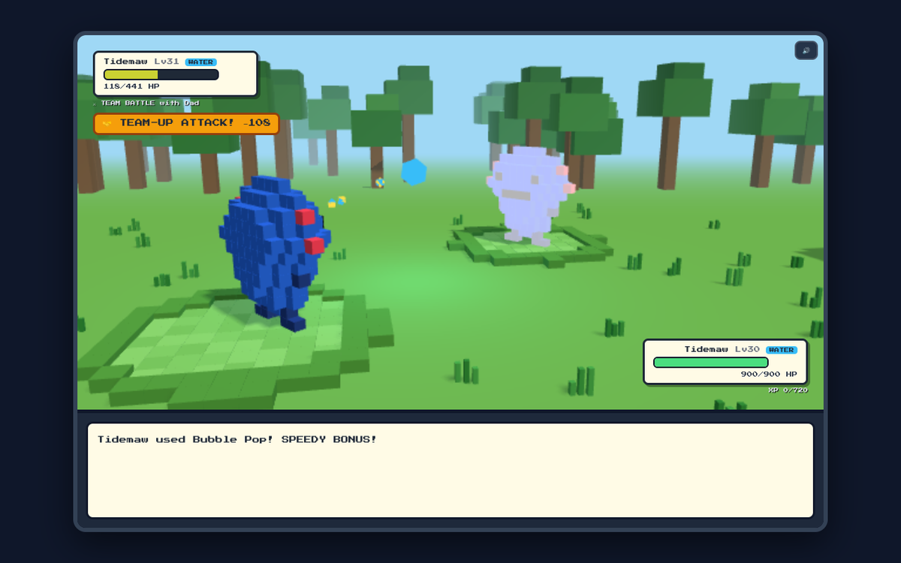
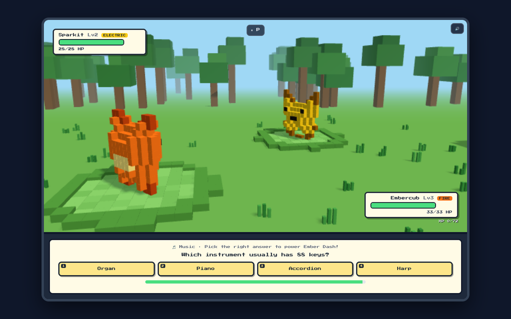

# 🐉 Mathimal Quest

**A 3D voxel creature-collecting adventure where every move is powered by a question. Play solo, or link two laptops and play together.**

Explore three regions, catch 16 original creatures called *Mathimals*, beat gym leaders and the Elite Four, and become Grand Champion. Answering correctly makes your Mathimals attack, catch and grow. Kids get adaptive maths; grown-ups can switch to general-knowledge quiz questions instead. That way a parent and child can play in the same world at the same time, each at their own level.

The game is one HTML file. Solo play works offline with nothing to install.


| Playing together | Team-Up attack | Grown-up quiz mode |
|---|---|---|
|  |  |  |

| Battle | Topic gym: reading a clock | Medals |
|---|---|---|
|  |  |  |

---

## ▶️ Play it

**Online (needed for two players):** open the GitHub Pages link for this repository in **Chrome** or **Edge**. See [Putting it on GitHub Pages](#-putting-it-on-github-pages) below.

**Offline (solo):**
1. Download **[`dist/mathimal-quest.html`](dist/mathimal-quest.html)**. On the file page, click **Download raw file**.
2. Double-click it to open it in Chrome or Edge.

Then press **PRESS START**, type your name, choose **🔢 Maths** or **🧠 General Knowledge**, and pick a partner.

It's designed for a **laptop or desktop with a keyboard**. Phones and tablets aren't supported.

> **Tip:** If the 3D view is slow on an older computer, press **3D** on the in-game HUD to switch to the 2D view.

A printable **[Field Guide & Trainer's Manual](docs/Mathimal-Quest-Field-Guide.pdf)** (14 A4 pages) covers every Mathimal, gym, item, medal and how to play together.

---

## 👥 Playing together

Two laptops share one world. Each player keeps their own adventure, team and save.

**Linking up**
1. Open the game on both laptops from the GitHub Pages link. Both need the internet.
2. Laptop 1: press **G**, then **HOST A GAME**. A 4-letter room code appears.
3. Laptop 2: press **G**, type the code, then press **JOIN**.
4. A partner panel appears in the top-right corner of both screens.

**What you can do**

| | |
|---|---|
| **See each other** | Your partner walks around your world (3D or 2D) with their name above them. |
| **🧭 GO TO** | Jump straight next to your partner, in any region you've unlocked. |
| **😄 Emotes** | **E**, then **1**–**6**: 👋 😄 👍 ❤️ 🎉 ❓ |
| **🎁 Gifts** | Send coins, potions or balls from your own bag. |
| **🔁 Trading** | Swap one Mathimal each; both players press ACCEPT. **Trade Evolution:** a Mathimal that hasn't evolved yet evolves the moment it arrives. |
| **⚔ Team battle** | One tough wild Mathimal with one shared HP bar. |
| **👹 Raid boss** | A giant boss, a 3-minute clock, and the boss joins both teams if you win. |
| **🤺 Duel** | Battle each other, three Mathimals each. You both answer your own kind of question at the same time, and the faster correct answer strikes first. |
| **🤝 Team-Up** | When both players answer correctly within 3 seconds of each other, they land a bonus hit worth half of both attacks. |

**Duels.** Press **🤺 DUEL** in the partner panel, pick up to three Mathimals in battle order, and send the challenge. The other player picks their team and accepts. Each round you both choose Quick or Power and answer at the same time. A wrong answer misses. If both are right, the faster answer (as a share of that question's time limit) hits first, and a Mathimal that faints first doesn't get to attack. First to knock out the other team wins.

- **Fair by design.** Every duelling Mathimal fights as a Lv20 copy with stats set by its species, so the result depends on answers and team choice, not on who has played more. Your real team is never hurt and nothing is used up.
- **Head start.** The challenger can give either player +10%, +20% or +30% damage.
- **Prizes come from the game.** The winner gets 60 coins and the loser 20, and each Mathimal that duelled earns XP. Nobody loses anything.
- **Scoreboard.** Duels won, lost and the current winning streak are on the Trainer Card (**I**). Two medals: Duellist and Duel Master.
- If the link drops mid-duel it ends as a draw. **🏳 FORFEIT** hands the win to the other player.

In a team battle or raid, each player answers their own kind of question on their own laptop. A child can be on maths while a parent is on general knowledge.

**How the link works.** The two laptops connect directly with WebRTC (via [PeerJS](https://peerjs.com)). The free PeerJS server only introduces them. Once they're linked, game messages go straight between the two laptops. In co-op battles the laptop that sent the invite keeps the shared HP and decides Team-Ups, so both screens always agree. In a duel the challenger's laptop is the referee: it collects both answers, works out the round and sends the result, and a lost result is sent again. If the link drops mid-battle, each player carries on solo.

**Advanced options** (added to the end of the address):
- `?slot=2` keeps a second, separate adventure in the same browser. For example, two windows side by side on one computer.
- `?net=local&slot=2` is test mode: two tabs in the same browser link up without the internet.
- `?peerhost=192.168.1.20&peerport=9000` uses your own [PeerServer](https://github.com/peers/peerjs-server) instead of the public one.

---

## ✨ Features

**Adventure**
- Three regions: the **Meadow**, the **Ember Caves** and the **Frozen Peaks**. Each one unlocks through progress.
- Day and night cycle, with different Mathimals out at night.
- Gym leaders, a recurring **rival**, the **Elite Four** gauntlet and **Grandmaster Aria**.
- **Trainer Tower**, an endless climb with escalating floors.
- **Aurion**, a legendary that appears only once every regular species has been caught.

**Collecting**
- 16 original Mathimals with evolutions at level 8 (or by trading), plus shiny variants.
- Common, uncommon and rare spawns.
- A team of 4 plus a Box.
- Seven ball types: Math, Great, Dusk, Net, Timer, Heal and Mega.

**Two question modes**
- **🔢 Maths: adaptive difficulty ("Maths Power" 1–10).** It covers addition, subtraction, times tables, division, missing numbers and word problems. It rises only on answers that are both correct and quick, so it tracks fluency rather than lucky guesses.
- **🧠 General Knowledge: 262 quiz questions** in three tiers. Topics are Aotearoa New Zealand, te reo Māori, geography, science, space, history, sport, arts and books, music, nature, food, technology, numbers and the human body. "Brain Power" rises as you get them right. Questions are dealt from a shuffled deck, so you don't see repeats until you've been through the tier.
- You can switch modes or rename yourself at any time on the Trainer Card (**I**).
- **Four Topic Gyms**, each with three levels that step up with practice:

  | Gym | Topic | Questions |
  |---|---|---|
  | 💰 Coin Gym | Money | New Zealand coins and notes, change, dollars and cents |
  | 🕒 Clock Tower | Telling time | Drawn analogue clocks: o'clock to 5-minute times, elapsed time |
  | 🍕 Fraction Forge | Fractions | Fractions of a number, fraction bars, comparing fractions |
  | 🔢 Number Vault | Place value and patterns | Digit values, rounding, number sequences |

- **Times-table stars** for mastering each table from 2 to 12.
- A **training report** showing accuracy and speed by question type.

**Rewards**
- **37 medals** that pay in-game coins.
- **Combo** meter and speed bonus.
- Shop, **mining and crafting** (wood, ore and crystal), Mystery Eggs, outfits and riding Mathimals.
- **Parent reward codes** that can be redeemed in-game for real-life wins. Only salted hashes are stored, so the codes can't be read from the source.

**Quality of life**
- Fully **keyboard-playable**: every battle button shows its hotkey.
- Pause, and a confirmation before running away.

---

## ⌨️ Controls

| In the world | | In a battle | |
|---|---|---|---|
| `W A S D` / arrows | Walk | `F` then `F` | Fight with a Quick attack (`1` Quick, `2` Power) |
| `C` | Mathi-Dex | `C` then `C` | Catch with a Math Ball (`1`–`7` picks a ball) |
| `B` | Box | `B` | Bag |
| `T` | Times-table stars | `S` | Switch Mathimal (`1`–`4`) |
| `M` | Medals | `R` | Run (`Y` / `N`) |
| `I` | Trainer Card (name and question mode) | `Enter` | Submit a typed answer |
| `G` | Play together | `1`–`4` | Pick a multiple-choice answer |
| `E` then `1`–`6` | Emote (when linked) | `P` | Pause |
| `P` | Training report | `Esc` | Go back |
| `H` | Hide / show HUD | | |
| `Esc` | Close a window | | |

---

## 💾 Saving

- **Auto-save** writes to the browser's `localStorage` on that computer. Reopen the game and choose **Continue Adventure**.
- **New Adventure** asks for confirmation first, and **Restore Previous Adventure** can bring the replaced game back.
- **Save codes** (💾 SAVE in the game) hold the whole adventure, including your name and question mode, as a checksummed code. You can copy it or download it as a `.txt` file. Use save codes to back up a game or move it to another computer.
- The duel scoreboard is kept in the auto-save, not in save codes (medals already won do travel with a code).
- Important changes (trades, gifts, rewards) save **immediately**, and the game also saves when a tab is closed or hidden. The 💾 SAVE window shows when it last auto-saved.
- **Earlier saves:** the game keeps a small history: a snapshot roughly every 10 minutes of play, the last 5 kept. You'll find them under **🕘 EARLIER SAVES** on the title screen.
- **One adventure, one tab.** If the same adventure is opened in a second tab or window, the first one saves and pauses, so the two can never overwrite each other. To keep a second, separate adventure on the same computer, add `?slot=2` to the address.
- If the browser blocks storage (for example, in a private window), a red warning appears so progress isn't lost silently.

Updating to a new version is safe. Older saves and save codes (v7 and v8) still load. They start as a maths player called "TRAINER", and you can rename them on the Trainer Card.

> The offline file and the GitHub Pages site are different web addresses, so the browser keeps a separate auto-save for each. To move a game between them, use a save code.

---

## 🌐 Putting it on GitHub Pages

The repository already contains a ready-built `index.html` at the top level, so there's nothing to build.

1. Push this repository to GitHub. It can be public.
2. On GitHub, open the repository, then go to **Settings** → **Pages**.
3. Under **Build and deployment**, set **Source** to **Deploy from a branch**.
4. Set **Branch** to `main` and the folder to `/ (root)`, then click **Save**.
5. After a minute or two, the page shows your address, for example `https://your-username.github.io/mathimal-quest/`. Open it on both laptops.

After changing the code, run `npm run build` and push again. Pages updates automatically.

---

## 🛠️ Building from source

The game is a React component in [`src/mathimal-quest.jsx`](src/mathimal-quest.jsx). The 3D world uses Three.js.

```bash
npm install
npm run build        # writes dist/mathimal-quest.html and index.html
```

[`build.mjs`](build.mjs) bundles React 18, Three.js and PeerJS into a single minified script with esbuild, then inlines it into one HTML file of about 940 KB.

### Project layout

```
├── index.html               # the game, served by GitHub Pages (same as dist/)
├── src/
│   ├── mathimal-quest.jsx   # the game: data, question generators, React UI, Three.js renderer
│   ├── gk.js                # general-knowledge question bank (grown-up mode)
│   ├── net.js               # two-player link: PeerJS (WebRTC) + same-browser test mode
│   └── entry.jsx            # mounts <App />
├── dist/
│   └── mathimal-quest.html  # the playable single-file build (for offline use)
├── docs/
│   ├── Mathimal-Quest-Field-Guide.pdf
│   └── screenshots/
├── build.mjs
└── package.json
```

### How it fits together

- **Rendering.** Creatures are 12×12 pixel sprites, extruded into voxel models at runtime and batched with `InstancedMesh`. The renderer adapts its quality to the computer's frame rate. It needs WebGL 2. On computers without it, or if the 3D renderer fails to start, the game switches itself to a 2D tile view and says so.
- **Questions** come from pure generator functions. Maths difficulty depends on Maths Power and, for topic gyms, on how many questions of that topic have been answered correctly. General-knowledge questions come from a tiered bank with balanced option lengths, and the correct answer's position is shuffled.
- **Saves** go through a single `validateState()` before they're applied, whichever path they come from: auto-save, save code or restore. Save codes are versioned (current format v9, with v7 and v8 still accepted) and protected by an FNV-1a checksum.
- **Networking.** Every incoming message is validated and clamped before it touches game state. The two laptops exchange a version handshake first. Trades, gifts and co-op battles stay switched off unless both run the same protocol.
- **Trades and gifts are transactions.** Each one has an ID and is recorded in the sender's save until the other laptop confirms it. A laptop confirms only after the change is safely saved, and IDs it has already applied are remembered. A message lost to a dropped link is resent (every few seconds while linked, and on the next link-up), and a repeat is never applied twice. A trade is decided by the host, and a Mathimal in an unfinished trade is locked. Co-op hits carry attack numbers, so a repeated hit counts once.
- **Limits** for coins (999,999), items (999 each) and resources are shared by gameplay, saves and save codes, so nothing earned is trimmed on reload.

---

## 🔒 Privacy

- No accounts, analytics or tracking. Progress lives in your own browser.
- Solo play doesn't need the internet. When online, the page loads its pixel font from Google Fonts. That's its only outside request.
- When you play together, the PeerJS server (and a public STUN server that helps the laptops find each other) sees their network addresses and the room code. After that, the two laptops talk directly. They share only what the game needs: player name, outfit, position, emotes, trades, gifts and battle hits.
- The player name is whatever is typed at the start. Nothing personal is built into the code.

---

## ✅ Testing

Before each release the game was checked with:
- automated play-throughs in a simulated browser, in both maths and general-knowledge mode
- logic-level acceptance tests for saving, validation, capacity limits, answer handling, profiles and reward codes
- real-browser keyboard tests in headless Chromium
- **two-player tests:** two real Chromium pages linked over WebRTC through a local PeerServer, checking linking, movement, emotes, teleporting, gifts, trades with trade evolution, leaving and rejoining, team battles with shared HP, Team-Ups, and raids where one player leaves
- **failure-injection tests:** messages deliberately dropped at each stage of a trade and gift (commit lost, confirmation lost, host tab closed mid-trade), repeated deliveries, instant double clicks, version mismatches, repeated co-op hits, two tabs on one adventure, closing a tab straight after a change, and computers without WebGL 2
- 36,000+ generated topic questions, each re-checked against an independent answer calculator

---

## 📜 Version history

| Version | Highlights |
|---|---|
| **v5.2** | **Duels:** challenge your partner to a three-a-side battle with level-matched teams, simultaneous questions, first strike for the faster correct answer, optional head start, prizes for both players, a duel scoreboard on the Trainer Card and two new medals. Network protocol 3: both laptops need v5.2 to trade, gift or battle together |
| **v5.1** | Fixes from an independent stress test: trades and gifts survive dropped links (IDs, confirmations, automatic resend, no double-applying); version handshake fixed and enforced; co-op hits can't count twice; Lucky Egg used up by co-op wins; one shared set of coin/item limits; corrupt creature IDs can't stall loading; WebGL 2 check with automatic 2D fallback; one-tab-per-adventure protection; instant saves, save-on-close and a rolling save history; names keep macrons and accents (Ā, Ē, É) |
| **v5.0** | **Two-player mode:** room codes, shared world, emotes, GO TO, gifts, trading with Trade Evolution, team battles, raid bosses and Team-Up attacks. **Grown-up mode** with 262 general-knowledge questions. Player names and profiles; hashed reward codes; save code v9 |
| **v4.4** | Equivalent fractions (1/2 = 2/4) accepted and never offered as two separate choices; Box capacity handled the same way everywhere; one-action-per-turn lock; battle timers cancelled when a battle closes |
| **v4.3** | Four Topic Gyms (money, time, fractions, place value); 35 medals |
| **v4.2** | Complete save codes, start-over protection with restore, save-failure warning, stronger save validation, pause fixes |
| **v4.1** | Full keyboard control in battles |
| **v4.0** | 3D voxel world and battles |
| Earlier | Meadow, Ember Caves and Frozen Peaks; gyms, rival, Elite Four, Trainer Tower and Aurion; catching, ball types, Mystery Eggs, mining, crafting and riding; adaptive maths, times-table stars, combo meter, Trainer Card and auto-save |

---

## 💛 Credits

Made as a family project. **PokeJosh**, the psychic fire dragon, was designed by the young trainer the game was made for.

All creatures, characters and artwork are original. Mathimal Quest isn't affiliated with any existing game franchise. Two-player networking uses [PeerJS](https://github.com/peers/peerjs) (MIT licence).

## Licence

Personal project. All rights reserved unless a `LICENSE` file says otherwise.
